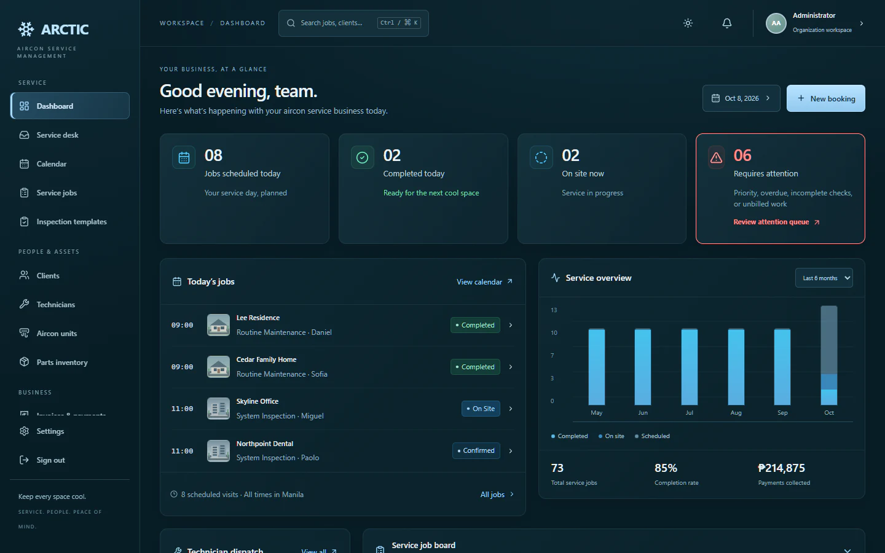
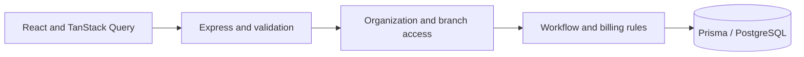

# ARCTIC AIRCON

**One workspace for service requests, field operations, and billing.**

An educational service-management application for a multi-branch aircon workflow. Staff coordinate requests, estimates, schedules, technicians, work orders, parts, invoices, and dated payment records.

[Live demo](https://arcticaircon.vercel.app/) · [Case study](https://vmargin.github.io/projects/arctic/)



## Implemented workflows

| Area | Capabilities |
| --- | --- |
| Service desk | Requests, customer sites, estimates, approval, and request-to-work-order handoff. |
| Scheduling and field work | Calendar, branch-scoped technician assignments, ordered booking lifecycle, configurable inspections, and field work orders. |
| Customers and equipment | Service history, unit records, and explicit next-maintenance dates. |
| Parts | Branch stock, restocks, adjustments, and work-order consumption. |
| Billing and reporting | One invoice per booking, separate dated receipts, open balances, service summaries, and billing CSV. |
| Workspace | Organization/branch permissions, audit records, search, and persistent light/dark appearance. |

## Architecture and rules



- Organization admins see their organization; branch leaders read and write within their own branch.
- Bookings follow `PENDING → CONFIRMED → ON_SITE → COMPLETED`; cancellation is allowed while open. Completed and cancelled records are terminal.
- A technician belongs to the assigned job's branch. Completed work can receive its invoice afterward.
- Each booking has at most one invoice. Money uses `Decimal(12,2)`; payment status moves forward.
- Stock operations are transactional and support retry-safe request keys. Writes retain an audit trail.

**Stack:** TypeScript, Express, Prisma, PostgreSQL, React, Vite, TanStack Query, Tailwind CSS.

## Run locally

Install Node.js 24 and PostgreSQL 14 or later. The local launcher finds PostgreSQL on Windows or accepts its binary directory through `PG_BIN`.

```powershell
git clone https://github.com/vmargin/arctic.git
cd arctic
npm run setup
npm run local
```

Open http://localhost:5000. The launcher creates its own PostgreSQL cluster on port 5433, `arctic_dev` and `arctic_test` databases, and local configuration under ignored `.local/`. It does not read `backend/.env` or use cloud data.

Local synthetic accounts share password `demo1234`:

| Account | Access |
| --- | --- |
| `admin@arctic.com` | All four demo branches |
| `south@arctic.com` | Makati |
| `north@arctic.com` | Quezon City |

Cavite and Bulacan are synthetic branches without seeded staff. These logins describe the isolated local seed, not a promise of hosted credentials. Stop the application with Ctrl+C, then run `npm run local:stop` to stop its database cluster. The local seed is additive and guarded; never run it against a hosted database.

## Deployment

The checked-in `vercel.json` builds `frontend/dist` and routes `/api` to `api/index.ts`, which exports the Express application. This is the configuration for the linked Vercel demo. The build includes a migration helper, so deployment requires a reviewed database target and migration history.

A separate `railway.json` supports a long-running Node service that serves the built frontend and API together. It is an alternative configuration, not the current demo's hosting topology.

Configure `DATABASE_URL` and a private random `JWT_SECRET`; use `NODE_ENV=production` and the proxy setting appropriate to the host. See `backend/.env.example` and the deployment scripts. No real records or cloud database are needed for the local instructions above.

## Verify

```powershell
npm run typecheck
npm test
npm run build
npm run test:integration
```

The integration command uses the isolated local test database. Historical workflow/browser evidence is in [verification](projects/arctic/context/engineering-loop/verification.md); the [motion record](plans/README.md) documents an earlier completed change. An HTTP response alone does not verify an authenticated workflow.

## Contribution and limits

I gathered requirements, defined workflows, made relational-data architecture decisions, and reviewed features and outputs. Development and deployment are AI-assisted. The demo uses invented records and does not establish real adoption or business impact.

Public customer booking, purchasing/transfers/truck stock, a technician mobile app, email/SMS delivery, and PDF invoice export are outside the implemented scope. Report age bands do not imply a due date or overdue status.

[Architecture](projects/arctic/context/engineering-loop/architecture-blueprint.md) · [Screenshot provenance](.github/media/README.md)

---

[More projects](https://github.com/vmargin) · [Portfolio](https://vmargin.github.io/) · [LinkedIn](https://www.linkedin.com/in/vmargin/)
